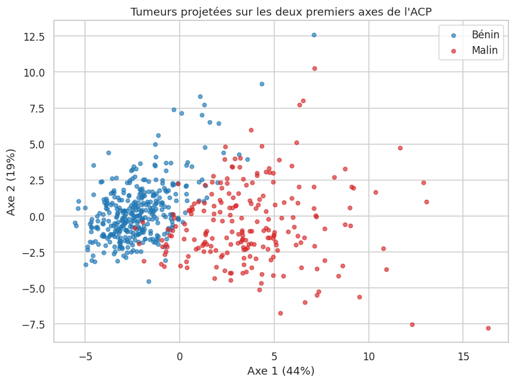
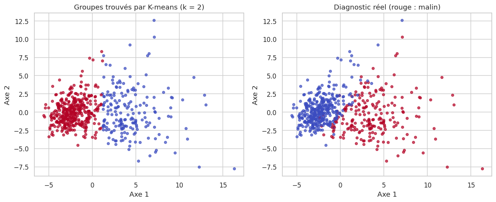
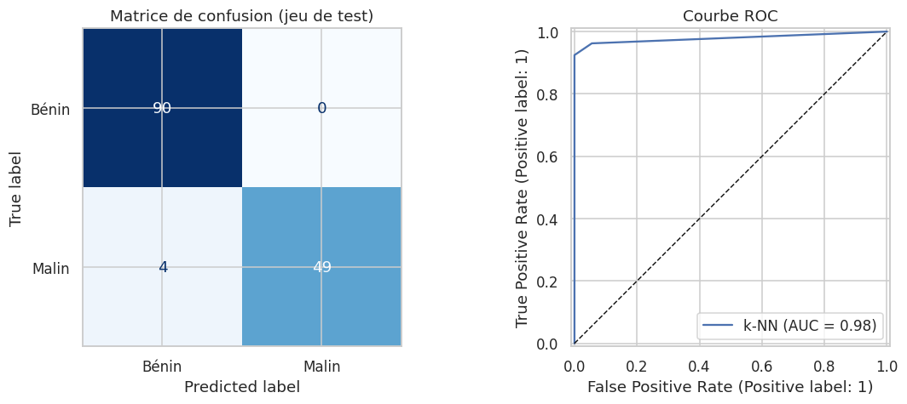

# Fondamentaux du machine learning : ACP, K-means et k plus proches voisins

Application rigoureuse de trois algorithmes classiques (ACP, K-means, k-NN) au jeu de données médicales **Breast Cancer Wisconsin (Diagnostic)** : 569 tumeurs du sein décrites par 30 mesures issues d'images de cellules, classées bénignes ou malignes. Le jeu **Iris** sert de second exemple.

L'objectif est autant de montrer **la méthode** (standardisation, validation, mesure de l'incertitude, comparaison à une référence) que les algorithmes eux-mêmes.



## Ce que le projet démontre

| Technique | Question | Résultat |
|---|---|---|
| **ACP** | Peut-on résumer 30 variables en quelques axes ? | 7 composantes conservent 90 % de la variance, 10 en conservent 95 %. Les 2 premiers axes expliquent 63 %. Sans standardisation, un seul axe capte 98 % de la variance, simplement à cause de l'échelle de l'aire |
| **K-means** | Les données se regroupent-elles naturellement ? | Sans connaître le diagnostic, 2 groupes retrouvent la structure bénin/malin à 91 % (indice de Rand ajusté de 0,67) ; groupes peu séparés (silhouette de 0,34) |
| **k-NN** | Peut-on prédire le diagnostic ? | Test : 97,2 % d'exactitude (IC à 95 % : 93 % à 99 %), 0 faux positif, sensibilité de 92,5 % (IC à 95 % : 82 % à 97 %), AUC de 0,979 |
| **ACP + k-NN** | Réduire la dimension nuit-il ? | 7 composantes donnent la même exactitude (0,965) que les 30 variables |
| **Comparaison** | Le k-NN est-il le meilleur modèle ? | Non : en validation croisée imbriquée répétée (50 évaluations), la régression logistique (97,7 %) fait légèrement mieux que le k-NN (96,7 %) |



## Bonnes pratiques mises en œuvre

- **Standardisation** des variables, avec démonstration chiffrée de son effet sur l'ACP et sur le k-NN.
- **Séparation entraînement/test stratifiée** ; le jeu de test n'est utilisé qu'une fois, à la fin.
- **Pipelines scikit-learn** : standardisation et ACP sont recalculées à chaque pli de validation, ce qui évite toute fuite d'information du test vers l'entraînement.
- **Choix des hyperparamètres** (k, distance, nombre de composantes) par validation croisée sur l'entraînement uniquement, avec comparaison de cinq distances (euclidienne, Manhattan, Minkowski p = 3, Tchebychev, Canberra).
- **Validation croisée imbriquée et répétée** pour comparer des modèles sans optimisme (le réglage est refait dans chaque pli d'entraînement).
- **Métriques adaptées au contexte médical** : sensibilité, précision, courbe ROC, matrice de confusion, avec intervalles de confiance de Wilson.
- **Modèle de référence** (régression logistique) pour ne pas conclure sur un seul algorithme.
- **Explicabilité** : importance par permutation, avec ses limites (variables corrélées).



## Limites (à lire avant d'interpréter)

- Un seul jeu de données de petite taille (569 tumeurs), sans validation externe. Un score de 97 % ici ne garantit pas la même performance en pratique clinique.
- En médecine, un faux négatif (tumeur maligne non détectée) est l'erreur la plus grave : la sensibilité de 92,5 % mesurée ici ne serait pas acceptable en l'état. Le projet est un exercice méthodologique, **pas un outil d'aide au diagnostic**.
- Les écarts entre distances proches ou entre modèles proches sont du même ordre que le bruit statistique.
- Pas d'optimisation du seuil de décision ni de calibration des probabilités.

## Structure du dépôt

```
ml-fondamentaux-pca-kmeans-knn/
├── notebooks/
│   └── 01_acp_kmeans_knn.ipynb   # analyse complète, sorties incluses
├── figures/                      # graphiques exportés
├── requirements.txt
└── LICENSE
```

Aucun fichier de données : les jeux Breast Cancer et Iris sont intégrés à scikit-learn.

## Reproduire l'analyse

```bash
git clone https://github.com/<Jean-Baptiste-99>/ml-fondamentaux-pca-kmeans-knn.git
cd ml-fondamentaux-pca-kmeans-knn
python -m venv .venv
source .venv/bin/activate        # Windows : .venv\Scripts\activate
pip install -r requirements.txt
jupyter notebook notebooks/01_acp_kmeans_knn.ipynb
```

## Données

- *Breast Cancer Wisconsin (Diagnostic)* : Wolberg, Street et Mangasarian, UCI Machine Learning Repository, chargé via `sklearn.datasets.load_breast_cancer`.
- *Iris* : R. A. Fisher (1936), chargé via `sklearn.datasets.load_iris`.

## Auteur

**Jean Paguiyendou KOMBATE** - Développeur et analyste de données, titulaire d'un master en génie logiciel, orienté données de santé et intelligence artificielle.

Licence du code : MIT.
